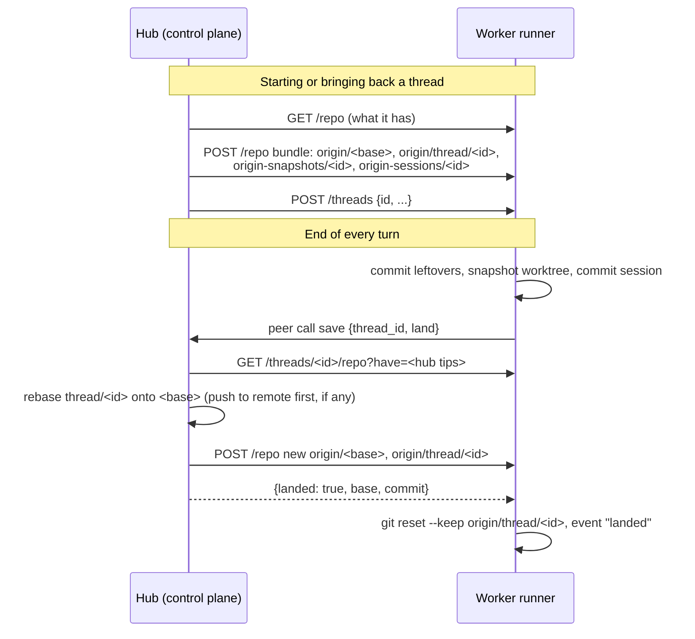

# Project repos and landing

Every project has its own git repository on the control plane's machine: a
bare repository at `.orchestrator/repos/<project id>.git`, the project's
**hub** (its path is under **Settings** in the project window). It starts from
an empty commit, "Start the project". It is the only place commits live beyond
a worker.

## What the hub holds

| Ref | What |
| --- | --- |
| `refs/heads/<base>` | the project's main branch (`main`, or the remote's default branch name once one is attached) |
| `refs/heads/thread/<id>` | each thread's branch, as of its last turn |
| `refs/snapshots/<id>` | each thread's whole worktree as of its last turn, untracked and ignored files included, as a child of its branch tip |
| `refs/sessions/<id>` | each thread's prime-agent session as of its last turn: its conversation (with compactions) and harness state |

Branches, snapshots and sessions together are everything a thread needs to
continue on another worker, which is what makes threads outlive workers.

## How commits move

Workers never reach the hub or any remote; workers get no git credentials at
all. The control plane moves commits both ways as **git bundles** over the
runner API. A bundle carries objects only, and leaves out a ref whose tip the
other side already has, so ref tips travel as JSON in an `x-git-refs` header.

On the worker, the hub's refs appear as remote-tracking refs of a repository
with no remote (`$RUNNER_WORKDIR/.repo`): `refs/remotes/origin/<base>`,
`refs/remotes/origin/thread/<id>`, `refs/remotes/origin-snapshots/<id>` and
`refs/remotes/origin-sessions/<id>`. Threads on one worker share that
repository's objects; each has its own worktree, index and branch.

## Every turn lands

There is no "finish" step. At the end of **every** turn:

1. The runner commits anything left uncommitted on `thread/<id>`, makes the
   snapshot (a commit of the whole worktree with a temporary index, `add -A -f`)
   and commits the session.
2. It asks the control plane to `save` (a [peer call](pull-mode.md#peer-calls)).
   The control plane pulls the three refs into the hub.
3. Unless a model call failed during the turn, it **lands**: the thread's
   branch is rebased onto the base in a temporary worktree of the hub (no merge
   commits). With a remote, the new tip is pushed there first, retrying up to
   5 times when the remote moved; only then does the hub's base move. The
   worker gets the new `origin/<base>` and `origin/thread/<id>` back, resets
   its branch onto it (`git reset --keep`), and logs `landed`.
4. A turn in which a model call failed is only taken, not landed (`saved`).
5. A conflicting rebase is answered with the files and the latest base. The
   thread gets a message from `runner` (`land_conflict`), rebases onto
   `origin/<base>`, resolves, and ends its turn, which lands again. A run of
   conflicts ends at the hop limit.

Agents are told to end every turn in a state fit for main, since that is where
it goes.

Because the hub has everything a thread had at the end of its last turn,
losing a worker loses at most the turn still running on it.

## Attaching a remote

A new project has no remote. A GitHub repository can be attached, changed or
removed at any time in **Settings** (`POST /api/projects/{id}/settings` with
`repo_url`). With one, the hub's base follows the remote's default branch (and
takes its name): it is fetched before workers get it and before every landing,
and every landing is pushed there first. Thread branches, snapshots and
sessions never leave this machine.

The control plane authenticates to GitHub with `GITHUB_TOKEN`, a fine-grained
token with **Contents: Read and write**, sent by git as the header
`Authorization: Basic base64("x-access-token:<token>")`
(`http.<repo url>.extraHeader`).

Attaching a remote joins the two histories (`Hub.connect`):

| The remote | What happens |
| --- | --- |
| has no commits | it gets the project's main branch |
| is ahead of the project, or nothing has landed in the project yet | the project's main branch takes the remote's commits; threads begun before land on top of them |
| is behind the project | it gets the commits it is missing (fast-forward push) |
| has a different history | refused with git's reason; the project keeps the remote it had |

Landing rebases with `--no-keep-empty`, so branches begun before a remote was
attached drop the empty "Start the project" commit. Removing the remote keeps
everything in the hub; landings stay local from then on, and attaching it
again pushes what it missed.
