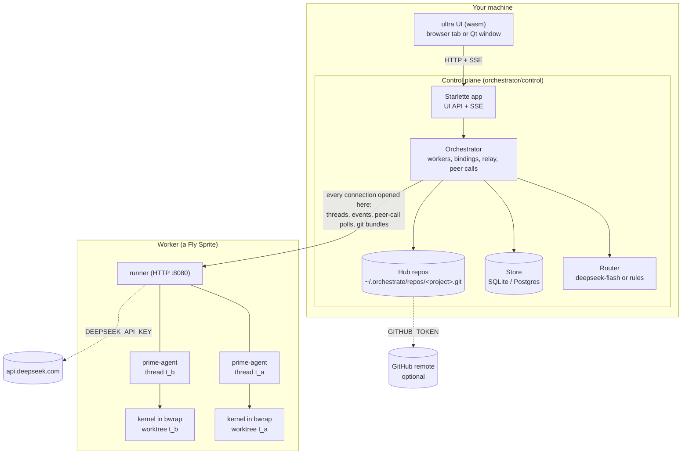

# Architecture overview

## The pieces

**The UI** (`orchestrator/ui/`) is an [ultra](https://prefix.dev/channels/nandi-testing/packages/ultra)
app: LPython compiled to WebAssembly, Elm-style. ultra ships only `http_get`,
so POST, server-sent events, clipboard, history navigation and Markdown
rendering are extra `@jscall` imports in `ui/orch.py` and `ui/imports.js`
(`ui/markdown.js` parses Markdown into render ops). It is one window: views are
panes, tabs and dialogs, never new windows. The [desktop window](../guide/desktop.md)
is a Qt web view on the same UI.

**The control plane** (`orchestrator/control/`) is a Starlette app.
`control/app.py` serves the UI and its API; `control/service.py` holds the
`Orchestrator`, which owns workers, threads' bindings, event relay, peer calls
and request handling. It writes everything to a `Store` (SQLite or Postgres)
as an append-only event log per project, which the UI reads and streams.

**The router** (`control/router.py`) turns a request into a plan: threads to
spawn and messages to existing threads. See
[Requests, routing and threads](routing.md).

**Providers** (`control/providers.py`) make workers: `SpritesProvider` (a Fly
Sprite per worker) and `LocalProvider` (a subprocess on this machine). The
router names each thread's place (`threads.workers`, "sprites" unless the
request says to run locally, then "local"); `Places` holds the provider of
each place this control plane runs workers in and why it refuses the others
(no `SPRITES_TOKEN`; not Linux; a phone), which the router is shown. A
thread on a refused place fails with that reason; nothing picks another
place for it.

**Workers** run the runner (`runner/`), one process hosting many threads
(capacity 16 by default), of any project. They are a fixed pool of 3 shared
by every project, not one per thread or per project: threads are cheap, and
a thread that finds the pool full waits for room. See
[The worker pool](../worker-lifecycle.md#the-worker-pool). Each thread is a prime-agent process
whose Python kernel runs sandboxed in its own git worktree. See
[The runner and prime-agent](runner.md).

**Hub repositories** (`control/hub.py`): every project has a bare git
repository on the control plane's machine. Each turn's work is taken from the
worker into the hub and landed on its main branch, and pushed to the project's
GitHub remote when it has one. See [Project repos and landing](git.md).

## Invariants

These hold everywhere; code that would break one is wrong, not a special case.

1. **The control plane is never reachable from a worker.** It opens every
   connection, including collecting peer calls. No callbacks, public URLs or
   tunnels. [Details](pull-mode.md).
2. **No API handler awaits the router, a provider or a runner.** Requests,
   spawns and messages return at once and run on background chains, ordered
   per project and per thread. [Details](routing.md#sending-never-waits).
3. **Every worker and binding state has a path back to happy**, checked when
   `states.py` loads; every change goes through `Orchestrator._worker_to` or
   `Orchestrator._bind_to`. [Details](../worker-lifecycle.md).
4. **Threads outlive workers.** What a thread needs to continue (branch,
   whole-worktree snapshot, model session) is in the hub after every turn, so
   any worker can take it up. Workers also outlive the control plane: stopping
   it lets go of workers without destroying them.
5. **Workers see only the project.** The orchestrate code, the runner's
   environment, other threads and every secret are outside a thread's sandbox.
