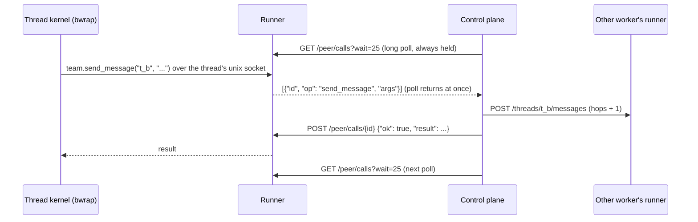

# Workers never connect in

The control plane is not reachable from workers, **by design**. It can sit on
a laptop behind NAT or a desktop that sleeps, and nothing about it has to be
exposed or tunnelled. It opens every connection to every worker, over the
worker's own URL, with `Authorization: Bearer <RUNNER_TOKEN>`.

There is exactly one mode. There is no public URL setting, no callback route,
no reachability detection and no websocket or tunnel. A worker is never told
where the control plane is.

## What the control plane opens

| Connection | Runner route | Purpose |
| --- | --- | --- |
| Health watch | `GET /health` | every 10 s, before every delivery, and when picking a worker; `boot` tells it the runner restarted |
| Event relay | `GET /events` (SSE, resumable by `seq`) | every thread's events, stored in the project log and streamed to the UI |
| Thread control | `POST /threads`, `POST /threads/{id}/messages`, `POST /threads/{id}/stop` | start, resume, message and stop threads |
| Peer calls | `GET /peer/calls?wait=25`, `POST /peer/calls/{id}` | the threads' calls to each other and to the project, below |
| Git | `GET /repo`, `POST /repo`, `GET /threads/{id}/repo` | moving commits between the hub and the worker as bundles ([details](git.md)) |
| Files | `GET /threads/{id}/files`, `/files/raw` | the UI's Files tab |
| Logs | provider APIs (Sprites log stream, local log file) | worker logs on the control plane's stdout and in the Worker log tab |

## Peer calls

A thread talks to the rest of the project through the **team skill**
(`team.list_threads`, `read_thread`, `send_message`, `spawn_thread`,
`set_summary`) from its kernel, and the runner calls `save` at the end of every
turn. Those calls need the control plane, which the worker cannot reach, so
they are queued on the worker and collected:

1. The kernel calls the team module, which writes to the thread's own unix
   socket (`$RUNNER_WORKDIR/.team/<id>.sock`, bound into its sandbox). The
   runner queues the call.
2. The control plane holds a long poll on every worker's `GET /peer/calls`. It
   returns the moment a call is queued.
3. The control plane runs each call concurrently, scoped to the worker's
   project (`Orchestrator.PEER_OPS` in `control/service.py`), and posts the
   answer to `POST /peer/calls/{id}`.

So threads on different workers, local or on Sprites, list, read, message and
spawn each other in one round trip through the control plane. A call handed
out but not answered within 60 s is handed out again; a tool waits up to 15
minutes for its answer (spawning may wait on a new worker). Messages between
threads carry a hop count, and one past 6 hops is dropped, which stops loops.

The full protocol is in the [runner API reference](../reference/runner-api.md#peer-calls-collected-by-the-orchestrator).

## Why this way

- The control plane is where you are: a laptop or desktop with no public
  address. Making it reachable would mean tunnels, auth on a public endpoint,
  and a second mode for when it is not reachable.
- Workers are disposable and many. Keeping all initiative on one side means
  one place decides what happens, and one place's logs show it.
- Long polls make this low latency: a peer call is answered as fast as a push
  would be, and an idle worker costs one held request.
