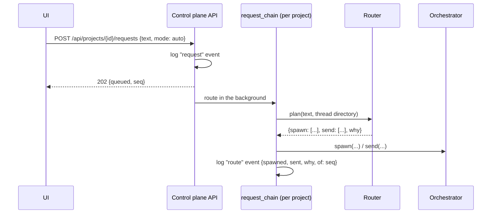

# Requests, routing and threads

You talk to the **project**, not to a thread. A request typed in the project
window goes to the router, which turns it into a plan; threads do the work and
talk to each other directly.

## From Enter to threads



1. `Orchestrator.submit` logs the request as a `request` event and returns.
2. Routing runs on the project's `request_chain`, so requests are planned in
   the order they were sent.
3. The router gets the text and the project's thread directory (each live
   thread's id, title, state, summary, files and [load](#thread-load)) and
   returns a plan:

    ```json
    {"spawn": [{"title": "Fix Safari export", "request": "..."}],
     "send":  [{"thread": "t_42", "message": "..."}],
     "why": "one sentence"}
    ```

4. Each spawn creates a thread (its `created` event holds the brief, shown in
   the UI as a neutral dashed row, not as your message) and starts binding it
   to a worker in the background. Each send is a message from `router` to an
   existing thread.
5. A `route` event records what was started and told, with `of` naming the
   request it planned. That link is what lets an [edit](#edits) find the
   threads a request reached.

The **This thread** and **New thread** modes skip the router: the plan is
"send to the selected thread" (from `user`, not `router`) or "spawn one". An
image-only request also skips it and spawns one thread.

### The routers

| Router | When | How it decides |
| --- | --- | --- |
| `ModelRouter` | always (`DEEPSEEK_API_KEY` is required) | Asks `deepseek-flash` with the directory as context. Its prompt says threads are cheap: prefer spawning, reuse a thread only when the request clearly continues its work and the thread is idle, split independent parts into several threads, and notify threads whose work the request touches. A busy thread is sent only what concerns its current turn; a backed-up or stalled one nothing it could do without, so new work goes to a new thread. |

A request the model cannot plan (unreachable, an answer that is not a plan, or
a plan that does nothing) is logged as an `error` event in the project; there
is no rule-based stand-in outside the tests (`tests/doubles.py`).

Plans are cleaned before use (`clean_plan`): sends to unknown threads and
empty entries are dropped, titles are capped at 80 characters. A project runs
at most 64 threads at once; a spawn past that is refused.

### Thread load

Each thread in the directory carries a `load`, made by `control/load.py` from
what the control plane already knows:

```json
{"level": "backed_up", "backlog": 2, "busy_for": 312}
```

- `backlog` is the messages to the thread it has not got to
  (`Store.backlog`): those not yet delivered to its runner, and those that
  came in during its current turn (they steer that turn, so they are still on
  its plate). The message that started the turn is not counted.
- `busy_for` is seconds since its current turn began (`threads.busy_since`,
  set when its state enters queued, working or waiting and cleared when it
  leaves them), 0 between turns.
- `level` is one of:

| Level | When |
| --- | --- |
| `idle` | not in a turn, nothing waiting: takes new work at once |
| `busy` | in a turn, being put on a worker, or one message on its way |
| `backed_up` | `backlog` is 2 (`load.BACKLOG`) or more: what it is sent now waits behind them |
| `stalled` | its worker is unreachable or being reattached: whatever it is sent waits for the worker |

The thread list API (`GET /api/projects/{id}/threads`, `GET /api/threads/{id}`)
returns the same `load`, and the UI shows the backlog as an "N waiting" badge
beside the thread's state, marked once the thread is backed up.

## Sending never waits

No API handler awaits the router model, a provider creating a worker, or a
runner call. That is why Enter clears the box at once even when a new sprite
takes a minute to boot.

- `POST /requests` with `mode: auto` answers 202 and routes on `request_chain`.
- `spawn` returns the thread at once, already in the `binding` state ("starting
  on a worker"); binding runs as a background task.
- `send` logs `message_in` itself and delivers on the thread's `thread_chain`
  once its binding is done, so messages to a thread still starting arrive, in
  order, when it starts. A message from another thread is that one event,
  with the sender as its `peer_id`, so both threads' logs list it and the UI
  shows it once, as "sender → recipient".

## Threads

A thread is a long-lived agent with its own git worktree on a worker. It is
created with a title and a request, runs turns, and then goes `idle` until its
next message; it does not end when a turn does.

- **Turns.** A turn starts with a request or a message and ends when the model
  stops calling tools. A message posted mid-turn steers it: the model reads it
  before its next call.
- **Summary.** After each turn the thread's summary (what it owns, which
  files) is updated in the directory, so the router and other threads know
  what it is doing.
- **Children.** A thread can spawn threads for independent work
  (`team.spawn_thread`). When a child's turn ends, it sends its parent
  `Finished: <summary>`.
- **Messages between threads** arrive as `[from t_xxx] <body>` and carry a hop
  count; past 6 hops a message is dropped with a `dropped` event.
- **Landing.** Every turn's work lands on the project's main branch. See
  [Project repos and landing](git.md).

Which worker a thread is on, and how it gets back on one, is the
[worker lifecycle](../worker-lifecycle.md).

## Edits

Editing one of your messages (`POST /api/projects/{id}/messages/{seq}/edit`)
logs an `edited` event and returns at once (202, or 200 when the text did not
change). Re-assessment runs on `request_chain`, after the original's routing:

1. The **reached** threads are the thread a direct message went to, plus every
   thread spawned or told by a `route` event whose `of` is the edited request.
2. Each live reached thread gets a correction from `user` with both versions.
   Nothing is stopped; ended threads come back and act on it.
3. `Router.revise(request, previous, reached, directory)` plans only what the
   corrections leave out. `ModelRouter` uses a revision prompt for which an
   empty plan is a fine answer. The result is logged as a `route` event with
   `mode: "edit"`.

## Events

Everything is an event in the project's log: `request`, `route`, `edited`,
and each thread's runner events (`created`, `state`, `message_in`, `delta`,
`reasoning`, `assistant`, `tool_call`, `tool_result`, `turn_done`, `saved`,
`landed`, `land_conflict`, ...), plus the control plane's own `worker_state`
and `binding` events. The UI reads them as JSON and follows them over SSE. A
reply still streaming arrives as `delta` events, folded into one growing row
per part; the event that ends the model call replaces them. The runner's event
types are listed in the [runner API reference](../reference/runner-api.md#sse).
