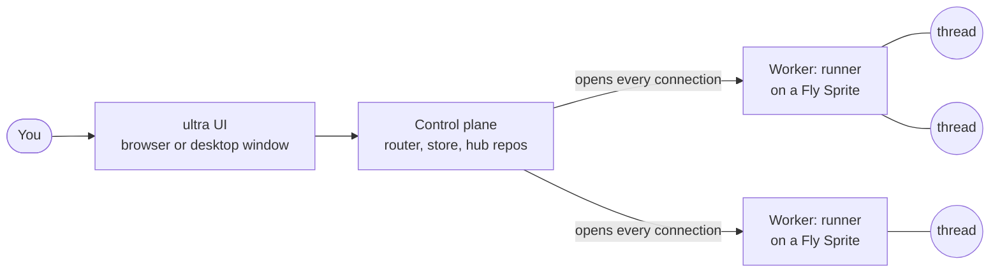

# orchestrate

orchestrate is a project-based agent orchestrator. You work in one window per
project. Every request you type there becomes one or more agent **threads**,
and those threads run on remote **workers** that host many threads each. The
threads can see, message and spawn each other, and every turn they finish
lands on the project's main branch.



The repository is a monorepo of two separate [pixi](https://pixi.sh) projects
that deploy separately:

| Directory | What it is |
| --- | --- |
| `orchestrator/` | The control plane (Starlette, SQLite or Postgres), the router, the per-project git hubs and the [ultra](https://prefix.dev/channels/nandi-testing/packages/ultra) UI, shown in a browser or in a Qt desktop window. |
| `runner/` | The agent runner: one process per worker that hosts many threads, each a [prime-agent](https://github.com/PrimeIntellect-ai/prime-agent) harness in a bubblewrap sandbox with its own git worktree. Linux only. |

The root `pixi.toml` is a front door that delegates to both, so everything can
be driven from the repository root.

## Five-minute start

```sh
git clone https://github.com/nandi-conda/orchestrate && cd orchestrate
pixi run setup                        # install every environment
pixi run set-key DEEPSEEK_API_KEY     # the model key, stored in the system keyring
pixi run set-key SPRITES_TOKEN        # run workers on Fly Sprites
pixi run desktop                      # the UI in a window, control plane in-process
```

`DEEPSEEK_API_KEY` is required: without it the control plane stops at startup
and says how to store it. See
[Getting started](guide/getting-started.md) for the details and
[Credentials and configuration](guide/configuration.md) for exactly what each
key is and how it is sent.

## Design rules worth knowing first

- **Workers never connect to the control plane.** It can run on a laptop
  behind NAT; it opens every connection, including the one that collects the
  threads' calls to each other. See [Workers never connect in](architecture/pull-mode.md).
- **Sending never waits.** Pressing Enter returns at once; routing, starting
  workers and delivery happen in the background. See
  [Requests, routing and threads](architecture/routing.md).
- **Threads outlive workers.** Each turn's branch, a snapshot of the whole
  worktree and the model session are taken into a local git repository per
  project, so a thread can come back on any worker. See
  [Project repos and landing](architecture/git.md) and
  [Worker lifecycle](worker-lifecycle.md).

## Building these docs

```sh
pixi run docs          # live-reloading site on http://127.0.0.1:8001
pixi run docs-build    # strict build into site/; a broken link fails it
```
