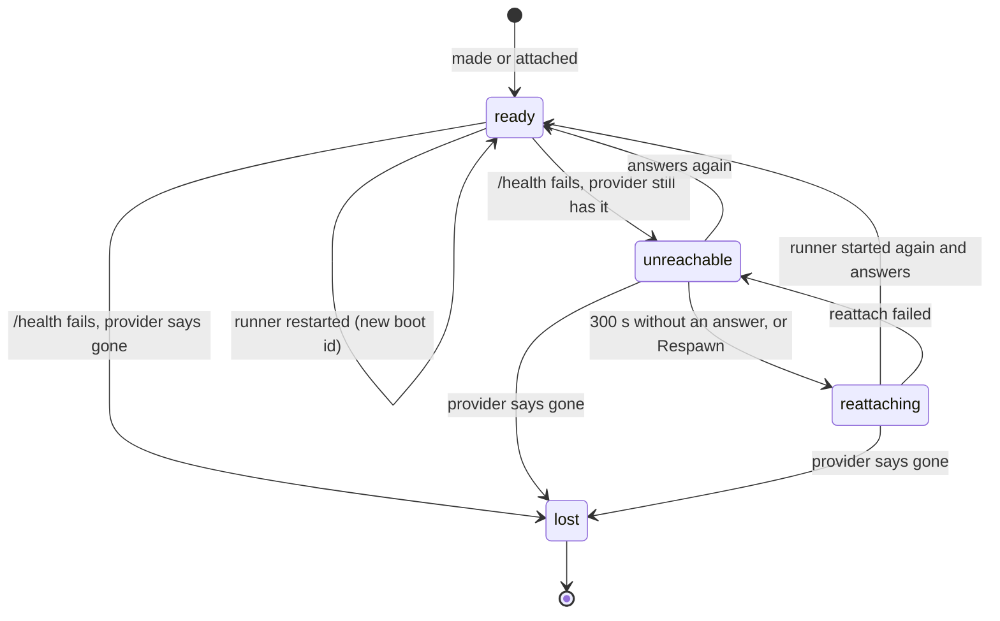

# Worker and thread lifecycle

## The worker pool

Workers run in one of two places, **Sprites** or **this computer**, and the
router decides per thread (`threads.workers`): Sprites, unless the request
asks to run locally ("run it locally", "on my machine"). It is told which
places this control plane can run workers in and why not the others (no
`SPRITES_TOKEN`, not Linux, a phone), and never picks one it cannot. A
thread spawned with no place (a **New thread** typed straight in, an API
`POST .../threads`) is placed by the router from its request when it is first
put on a worker; a thread a peer spawns runs where its parent runs. A request
the router sends to an existing thread can move it ("@t_ab12 run this
locally"): it is stopped where it runs and comes back on the other place with
that message. Each place has a **pool of 3, shared by every project**
(`POOL` in `orchestrator/control/service.py`). Each worker sits in a
numbered slot of its place's pool, and a slot always names the same worker:
`orch-w1`, `orch-w2`, `orch-w3` on Sprites (labeled `orchestrator`),
`w1`..`w3` on this computer. A thread only ever goes on a worker of its own
place. That is the whole lifecycle policy:

- **Made only to fill an empty slot.** A thread goes on the least loaded
  ready worker with room (16 running threads each). When none has room, it
  **does not wait**: it goes on the least loaded ready worker anyway (16 only
  spreads threads; the runner sets no limit), and the first empty slot, if
  any, is filled in the background for the threads after it. Only when no
  worker of its place answers at all does a thread wait: for the slot being
  filled, or, with every slot filled, for the first worker that answers ("no
  … worker answers" on its Now line). No fourth worker is ever made.
- **Kept, not destroyed.** Workers outlive the control plane, and a sprite
  pauses on its own while nothing is connected to it, so an idle pool costs
  little. A lost worker's slot is filled again by a new worker of the same
  name.
- **Swept at startup, in the background.** As it starts, the control plane
  lists each place's workers and destroys every one of ours that is not a
  slot (starting never waits for this: a provider that is slow or out of
  reach holds nothing up, and a sweep that fails is logged and tried again on
  the next start; the slots themselves are never touched, so work goes on
  meanwhile): each
  project's own workers from before the pool (`orch-p-<id>-w<n>`), slots
  beyond the pool's size, and the pool of a control plane whose store is
  gone. The store marks the ones it knew as lost, with why. Sprites not named
  `orch-` with the label or the old per-project names are never touched.
- **Projects share workers, not repositories.** A worker keeps one
  repository per project (`.repos/<project>`), a thread sees only its own
  project's, and each peer call is answered within the calling thread's
  project. Archiving a project takes it off every worker (its repository,
  worktrees, homes); its hub keeps everything, so unarchiving brings its
  threads back on the pool.

One control plane uses a Sprites organization's pool at a time: a second one
pointed at the same token attaches to the same slots and restarts their
runners under its own token.

## Worker states and thread binding

The control plane tracks two things for every running piece of work:

- **the worker**: a machine (a sprite, or a local process) running the runner
  that hosts threads;
- **the thread's binding**: whether, and how, a thread is on a worker.

Each is a small state machine, defined in one place:
[`orchestrator/control/states.py`](https://github.com/nandi-conda/orchestrate/blob/main/orchestrator/control/states.py).
On top of the binding sits the thread's **run state** (queued, working, idle,
...), which the runner reports and which only means something while the
thread is bound.

The rule all three follow: **every state has a path back to happy** (a ready
worker, a bound thread). The one exception is a lost worker, which is gone for
good; its threads take the path back on another worker instead. `states.py`
checks this when it loads, so a state with no way back cannot be added.

### Worker states



| State | Means | What moves it | Way back to ready |
| --- | --- | --- | --- |
| `ready` | its runner answers `/health` | | |
| `unreachable` | `/health` fails but its provider still has it: a sprite waking from a pause, or this machine's network down | a failed health check (every 10 s, before every delivery, when picking a worker) | it answers again; or reattached |
| `reattaching` | the provider is starting its runner again, on the same disk and with the same token (Sprites restarts the runner service; a local worker gets a new process) | 300 s (`READY_TIMEOUT`) unreachable | ready once it answers; unreachable again if it fails, and another try 300 s later |

**Work never waits for a worker to answer.** A message to a thread whose
worker is unreachable or reattaching moves the thread to a ready worker of
the pool at once, from its branch, snapshot and session in the hub, and is
delivered there. A turn it had under way on the old worker is cut short: it
goes on from its last saved turn. The old worker keeps the thread on a
"moved off" list: once it answers again the thread is stopped there, and
until then nothing it sends for that thread is taken (its peer calls for it
are refused, since the thread is no longer on it). A thread no work comes
for while its worker is away stays on it and carries on when it answers.
| `lost` | its provider says it no longer exists | a failed health check whose provider lookup says gone | none: it is destroyed and its slot filled again by a new worker of the same name. Its threads are unbound and come back on the pool |

`ready → ready` is a runner restart: `/health` returns a new `boot` id (the
runner crashed, a sprite woke cold, or it was reattached). The new runner runs
none of the old threads. A thread whose turn was under way (queued, working,
waiting) is put back on this worker at once, and the runner resumes the turn
it cut short (see [Interrupted turns](#interrupted-turns)). The rest are
unbound, keeping this worker as theirs: they come back on it, in their
worktree, with their next message.

## Interrupted turns

Restarting a runner ends every turn under way on it, so it is restarted only
when it has to be:

- **Attaching does not restart a runner that is already right.** The control
  plane fingerprints the sprite service it would define (the commit, model
  key, token and settings) and passes it as `RUNNER_SPEC`; the runner reports
  it in `/health` as `spec`. When a sprite's runner already reports the
  fingerprint this control plane would start it with, attaching (a new
  control plane, a reattach) leaves it running. A different commit on the
  branch, another key or another token restarts it.
- **A cut turn resumes; it does not fail.** When the runner is stopped
  (SIGTERM from the service manager), it marks itself stopping before its
  threads' prime-agents die, logs `turn was cut short by the runner's
  shutdown` and reports no error. While a turn runs the runner keeps
  `.team/<id>.turn` on the worker's disk. The control plane puts each thread
  that was mid-turn back on its worker (`binding` reason `… restarted
  mid-turn; putting it back there …`), the runner sees the file, and the
  thread gets a message from `runner` saying its turn was cut short, with its
  conversation and worktree (uncommitted files included) as the cut left them.
  It is bound with `resuming the turn its runner's restart cut short`. A crash
  resumes the same way; a prime-agent that dies while its runner goes on
  fails the thread, with the signal named (`prime-agent was terminated by
  SIGTERM (exit 143)`).
- **A control plane restart goes on with turns under way.** Taking over a
  project, a new control plane puts its mid-turn threads back on their
  workers at once: one whose runner still runs it is found again there; one
  whose runner had to restart resumes. Idle threads are unbound as before.

A worker is never lost just for not answering. Only its provider saying it is
gone loses it.

### Thread binding

```mermaid
stateDiagram-v2
    [*] --> binding: thread created
    unbound --> binding: next message, or Respawn
    binding --> bound: worker picked, hub shipped, thread posted
    binding --> unbound: failed, or called off (Respawn, Stop)
    bound --> unbound: worker lost; runner or control plane restarted (idle threads)
    bound --> binding: Respawn, a message to a thread whose turn ended, or a restart mid-turn
```



| Binding | Means | Way back to bound |
| --- | --- | --- |
| `bound` | a live worker's runner has the thread | |
| `binding` | being put on a worker: one picked (a slot filled, or the first worker to answer when none does), the project's hub shipped to it, the thread posted | bound when that finishes; unbound if it fails or Respawn starts it over |
| `unbound` | on no worker | its next message, or Respawn |

Each move is stored with its reason (`threads.binding_reason`) and logged as a
`binding` event in the thread's log. Reasons you will see for `unbound`:

- `worker … is lost (…)`: its provider says the worker is gone.
- `worker …'s runner restarted`: a new runner on the same worker; the thread
  was idle.
- `the control plane that had it on worker … stopped`: this control plane
  started after another one had the thread, which was idle; it comes back on
  that worker with its next message.
- `could not put it on a worker: …`: the start failed; the error says why.
- `Respawn called off putting it on a worker, to start over` /
  `stopped before it was on a worker`.

**Where a thread goes when it is bound.** On the worker it was last on, while
that worker is ready, so it continues in the same worktree (uncommitted and
ignored files included). One that does not answer is not waited for.
Otherwise on the least loaded ready worker of the pool, over 16 if need be
(an empty slot is filled in the background), from its branch, snapshot and
session in the hub. If its runner still runs it
(only the control plane lost track), it is bound as it is: "found again on
worker …". A thread with no saved turn yet gets its original request again;
the rest come back idle and wait for their next message.

## Run state, and what "queued" means

The run state is the runner's: `queued`, `working`, `waiting`, `idle`,
`done`, `failed`, `stopped`.

- `queued`: the runner has the thread but its first turn has not started.
  It lasts a moment; the runner moves it to `working` as soon as the turn
  begins. It is also the state a thread is created with, before any runner
  has reported on it.
- `working`, `waiting`: a turn is under way (`waiting` on a peer).
- `idle`: between turns, waiting for its next message.
- `done`, `failed`, `stopped`: its turn ended; a message brings it back.

A run state is only true while a runner has the thread, so **the UI shows it
only for a bound thread**. A thread on its way to a worker shows `binding`,
and one on none shows `unbound`, plus `failed` or `stopped` when its turn
ended that way. Unbinding a thread mid-turn (queued, working, waiting) marks
it `failed`, since its turn was cut short; a runner or control plane restart
does not unbind one, it resumes the turn instead.

So a thread showing `queued` for more than a moment is bound, and its runner
has not started its turn. Check its Worker log; Respawn re-posts it.

The other "queued" in the code is unrelated: sending a request returns
`{"queued": true}` to say routing runs in the background. It is never shown
as a thread's state.

## What you see in the UI

- **Badges** next to a thread's title (in the list and the open pane): its
  run state while bound, plus `worker unreachable` / `worker reattaching`
  when its worker is not ready; its binding (`binding`, `unbound`) otherwise.
- **The red bar** under the title appears when a thread is unbound or its
  worker is not ready. It shows the binding, its reason, the worker's state
  and reason, and that Respawn brings it back.
- **Now:** while binding, the activity line names the step under way
  (`picking a worker of the pool`, `waiting for worker slot 2 to come up`,
  `sending worker orch-w1 the bundle (12 KiB)`, ...), with how long it has
  taken once it passes 15 seconds.
- **The Files tab** of a thread on no ready worker answers at once with
  where the thread stands, and lists the files once its binding event says
  it is bound. Opening it puts no thread on a worker.
- **The project log** shows `worker_state` events (`worker unreachable`,
  `worker ready`, ...) with their reasons, in every project with a thread on
  that worker or last on it; a thread's log shows its `unbound` moves.
- **The Worker log tab** opens with two lines, then the worker's runner log:

  ```text
  thread t_ab12 is bound: on worker orch-w1, idle until its next message
  worker orch-w1 is ready: its runner answers again
  ```

  Then, once a thread has been put on a worker by this control plane, the
  steps of its latest binding, timed, and the steps of the worker being made
  or reattached for it, if it waited on one (see "Binding steps" below).
  For a thread whose worker was lost, it shows the end of that worker's log
  as it was followed before the worker was destroyed.

## Binding steps

Putting a thread on a worker, and making or reattaching a worker, are logged
step by step, to the control plane's stdout and to the thread's Worker log
tab. Each step is logged when it starts, every 15 seconds while it runs
(`still ... (45s so far)`) and when it ends (`done in 3.2s`, or
`failed after 300.0s: ...`), so a binding that stalls always says what it is
waiting on:

```text
INFO:orchestrator:thread t_ab12: picking a worker of the pool ...
INFO:orchestrator:thread t_ab12: waiting for worker slot 1 to come up ...
INFO:orchestrator:worker orch-w1: making sprite orch-w1, or finding it made ...
INFO:orchestrator:worker orch-w1: asking its runner whether it is orchestrate 1a2b3c4d5e6f as this control plane would start it (up to 60s: a paused sprite wakes) ...
INFO:orchestrator:worker orch-w1: installing orchestrate 1a2b3c4d5e6f on it (git fetch, pixi install, prime-agent) ...
INFO:orchestrator:worker orch-w1: still installing orchestrate 1a2b3c4d5e6f on it (git fetch, pixi install, prime-agent) (45s so far)
```

A step the runner refuses fails with the runner's own words, not just its
status, so the line says what to fix:

```text
WARNING:orchestrator:thread t_ab12: sending worker orch-w1 the bundle (1 KiB): failed after 0.2s: RunnerError: the worker answered 400 to POST /projects/p_1/repo: refs the orchestrator may not set: refs/heads/x
```

A worker being made holds up no thread while another worker of the place
answers: threads bind on the least loaded ready one meanwhile, and only a
thread with no worker answering at all waits for it. A sprite is reinstalled and its runner
restarted whenever the commit, model key, token or settings it would run
with changed since it was started (a new commit on the branch the control
plane's checkout follows is the usual one); otherwise its runner is left
running and the attach takes seconds. Respawn of a thread waiting on a
worker being made calls that attach off too, and it starts again.

### Posting a thread to its runner

`POST /threads` answers at once: the runner registers the thread `queued`
and makes its worktree and session afterwards, in the thread's own task. That
can take minutes (a worktree made again from the hub writes every file of its
snapshot, ignored build output included), and a request held open that long
is cut off (the control plane's 30 s read timeout, and Fly's proxy). The
thread is bound as soon as the runner answers. Each step of making it
arrives as a `preparing` event (the thread's activity: "making its worktree",
"taking its session"), and the end as `prepared`, which says whether it
resumes a turn cut short there, goes idle, or works on its request; the
Worker log tab shows that line. The thread is on a job from the start
(busy), so it is sent only steering meanwhile, and that steers its first turn
from the moment the turn begins; new work goes to a new thread. If making it fails, the thread reports the error and goes `failed`;
Respawn starts it again. Until it is made, the Files tab says "its worktree
is still being made".

### Waking a cold sprite

A cold sprite's services API answers `500 services manager not started`
until the sprite has booted it, so looking for its runner service waits that
answer out, for up to 60 seconds, asking again every second. Any other
answer, or that one after 60 seconds, is an error.

### Installing on a sprite

The install (git fetch, `pixi install` of the runner's environments,
prime-agent) takes minutes, longer than one request through the Sprites API
should be held open: a held `POST /exec` came back as a bare 502 from the
API's gateway mid-install. So it runs detached on the sprite, in
`/home/sprite/.orchestrate-install/<commit>-<id>/`: one short exec starts it
in its own session and returns, and a short exec every 5 seconds looks at it,
adding the lines it wrote since to the Worker log as `install | ...`. While it
runs it holds the sprite active with a task on the sprite's Tasks API (a
5 minute hold refreshed every minute, released when it ends), so the sprite
does not pause under it. It ends one of four ways, each its own error with
the end of its output: it exits 0 (the runner service is then put), it exits
non-zero, it is gone without an exit code (the sprite rebooted under it), or
it runs past 30 minutes.

Every exec's output and exit code are read from files on the sprite
(through the filesystem API), never from the exec's response: that body
multiplexes stdout, stderr and the exit code in frames with a stream byte and
no length, which cannot be parsed reliably.

A Sprites API call that fails says what the API answered: the status, how
long the call took, the request id its proxy gave it, and the body, or that
it had none.

## Respawn, from each state

Respawn (the button on every thread, or `POST /api/threads/<id>/respawn`)
returns at once; the thread's `binding` events show how it went.

| The thread is | Respawn |
| --- | --- |
| `unbound` | binds it: on its last worker if that is not lost, else on a picked one |
| `binding` (stuck starting, e.g. a sprite that never comes up) | calls the start off (`binding → unbound`) and starts again; messages sent meanwhile wait for the new start and are delivered |
| `bound`, worker `ready` | stops it on its runner and posts it again (`bound → binding → bound`); a turn under way is cut short |
| `bound`, worker `unreachable` or `reattaching` | reattaches the worker first (its runner is started again), then binds the thread on it |
| worker `lost` | its threads are already unbound; Respawn binds them on the pool |

## Messages to a thread in each state

A message is logged at once and delivered in the background, in order:

- **bound, worker ready:** delivered.
- **binding:** waits for the binding to finish, then delivered.
- **unbound, or its turn ended:** the thread is bound first, then delivered.
- **bound, worker unreachable:** waits for the worker to be ready again (it
  answers, or is reattached after 300 s); if a reattach fails, the message
  fails with the worker's state and reason in the thread's log.

## For developers

- Change a worker's state only with `Orchestrator._worker_to`, and a
  binding only with `Orchestrator._bind_to`. Both check the move against the
  machine (`IllegalTransition` on a move it does not list: a control plane
  bug), store the reason and log the event.
- `_bind` is the single path that puts a thread on a worker, for a new thread
  and a returning one alike; `live_worker` is what anything needing the
  thread's worker calls.
- `_probe` looks at a worker once and moves it; `_watch` calls it every 10 s.
- Adding a state means adding it to `states.py` with its moves; the module
  refuses to load if the new state has no way back to happy.
